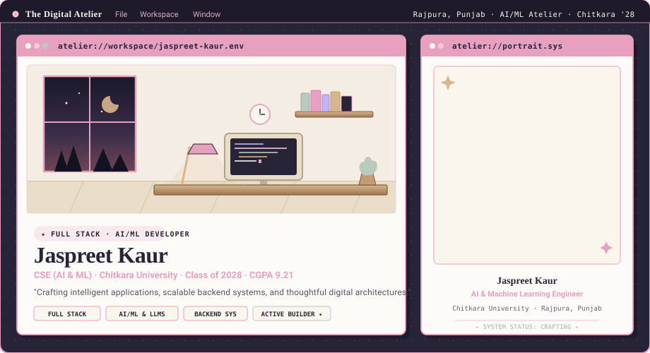
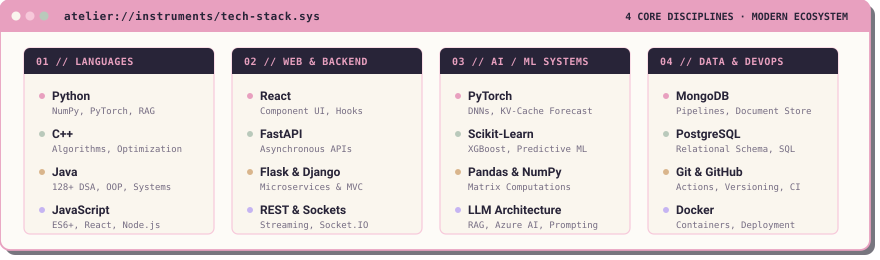
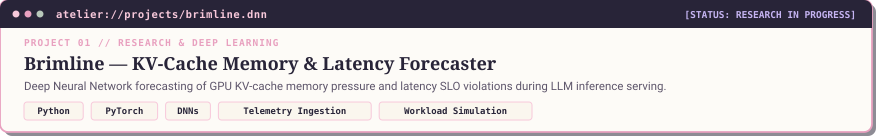
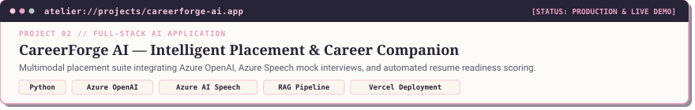
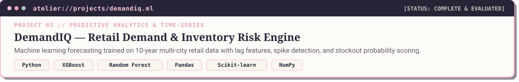
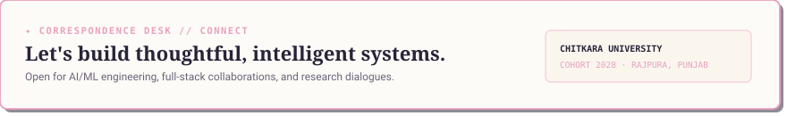

<div align="center">

<!-- RETRO DIGITAL ATELIER: VINTAGE DESKTOP HERO -->
<a href="https://github.com/jaspreetxkaur">
  
</a>

</div>

<br/>

## `✦ /ABOUT THE ATELIER`

<div align="left">

> *"I build intelligent applications, engineer backend systems, and turn ideas into working software."*

I am a Computer Science & Engineering student specializing in **Artificial Intelligence & Machine Learning** at **Chitkara University** (Class of 2028 · CGPA: 9.21). My engineering work lives at the intersection of full-stack development, modern backend architectures, and intelligent systems powered by AI/ML and LLM infrastructure.

Rather than treating software engineering as syntax alone, I approach it as craftsmanship—studying distributed data flows, memory latency bottlenecks, database schema indexing, and deploying resilient services that solve actual problems.

```
• Academic Base    : B.E. Computer Science & Engineering (AI & ML) · Chitkara University
• Graduation Class : 2028 (Rajpura, Punjab)
• Current Focus    : Scalable Backend Systems · Generative AI / RAG Pipelines · LLM Inference Dynamics
• Problem Solving  : 128+ Algorithmic Challenges Solved in Java (Trees, Graphs, DP)
```

</div>

<br/>

---

## `✦ /INSTRUMENTS & TECH STACK`

<div align="center">
  <!-- ATELIER TECH STACK CANVAS -->
  
</div>

<br/>

<div align="left">

| Discipline | Core Technologies & Stacks |
| :--- | :--- |
| **Languages** | `Python` · `C++` · `Java` · `JavaScript (ES6+)` · `SQL` · `HTML5` · `CSS3` |
| **Frontend & Web** | `React` · `Component Architecture` · `Responsive UI Design` · `Modern CSS` |
| **Backend & APIs** | `FastAPI` · `Flask` · `Django` · `Node.js` · `REST APIs` · `Socket.IO` · `JWT` |
| **AI / Machine Learning** | `PyTorch` · `Scikit-learn` · `NumPy` · `Pandas` · `DNNs` · `RAG Pipelines` · `LLM APIs` |
| **Data & Infrastructure** | `MongoDB` · `PostgreSQL` · `SQLite` · `Git` · `GitHub Actions` · `Docker` |

<br/>

<!-- ELEGANT VINTAGE-TINTED TECH BADGES -->
<p align="center">
  &nbsp;
  &nbsp;
  &nbsp;
  &nbsp;
  &nbsp;
  &nbsp;
  &nbsp;
  &nbsp;
  
</p>

</div>

<br/>

---

## `✦ /FEATURED PROJECTS`

<!-- PROJECT 01: BRIMLINE -->
<div align="left">

<a href="https://github.com/jaspreetxkaur/BrimLine--KV-Cache-forecast">
  
</a>

**`Brimline`** &nbsp;·&nbsp; `Deep Learning & LLM Infrastructure` &nbsp;·&nbsp; `[STATUS: RESEARCH IN PROGRESS]`  
*Exploration into Deep Neural Network forecasting of GPU Key-Value (KV) cache memory saturation and latency SLO violations during LLM inference serving.*

- **Controlled Workload Simulator:** Developed a custom Python harness simulating heterogeneous token generation bursts and prompt length distributions.
- **Telemetry Processing:** Ingests live operational metrics including input/output token volume, prompt arrival rates (QPS), and instantaneous GPU memory utilization.
- **Engineering Direction:** Training lightweight neural forecasters to predict memory spikes before out-of-memory evictions occur, minimizing tail latency degradation.
- **Stack:** `Python` · `PyTorch` · `Deep Neural Networks` · `Workload Simulation`
- **Repository:** [📦 github.com/jaspreetxkaur/BrimLine--KV-Cache-forecast](https://github.com/jaspreetxkaur/BrimLine--KV-Cache-forecast)

</div>

<br/>

<!-- PROJECT 02: CAREERFORGE AI -->
<div align="left">

<a href="https://github.com/jaspreetxkaur/CareerForge-AI">
  
</a>

**`CareerForge AI`** &nbsp;·&nbsp; `AI Application & Full-Stack Development`  
*An intelligent placement and career companion that combines automated resume analysis, readiness scoring, personalized roadmaps, and multimodal mock interviews.*

- **Azure AI Multimodal Pipeline:** Integrates Azure OpenAI and Azure AI Speech services for realistic conversational interview simulations.
- **Speech & Behavioral Analysis:** Processes audio and camera inputs to evaluate speaking pace, filler-word frequency, and response latency.
- **Placement RAG Architecture:** Domain-specific retrieval pipeline providing context-aware guidance tailored to university campus recruitment patterns.
- **Stack:** `Python` · `Azure OpenAI` · `Azure AI Speech` · `RAG` · `REST API` · `Vercel`
- **Repository:** [📦 github.com/jaspreetxkaur/CareerForge-AI](https://github.com/jaspreetxkaur/CareerForge-AI) &nbsp;·&nbsp; **Live Demo:** [🚀 career-forge-ai-navy.vercel.app](https://career-forge-ai-navy.vercel.app/)

</div>

<br/>

<!-- PROJECT 03: DEMANDIQ -->
<div align="left">

<a href="https://github.com/jaspreetxkaur/AI-powered-Demand-Forecasting-Model">
  
</a>

**`DemandIQ`** &nbsp;·&nbsp; `Machine Learning & Predictive Analytics`  
*A machine learning time-series demand forecasting and inventory risk mitigation system trained on a 10-year weekly dataset across 6 cities, 20 categories, and 100 SKUs.*

- **Feature Engineering:** Constructed rolling lag features, multi-window moving averages, volatility indicators, and spike detection algorithms.
- **Seasonal Modeling:** Incorporated localized festive and calendar events to anticipate consumer demand spikes.
- **Inventory Risk Scoring:** Quantitative heuristic assessing product-city-week stockout risk versus overstock carrying cost probabilities.
- **Stack:** `Python` · `XGBoost` · `Random Forest` · `Pandas` · `Scikit-learn` · `NumPy`
- **Repository:** [📦 github.com/jaspreetxkaur/AI-powered-Demand-Forecasting-Model](https://github.com/jaspreetxkaur/AI-powered-Demand-Forecasting-Model)

</div>

<br/>

---

## `✦ /LAVENDER CONTRIBUTION TELEMETRY`

<div align="center">

<!-- GENUINE ANIMATED LAVENDER SNAKE -->
<a href="https://github.com/jaspreetxkaur">
  
</a>

<br/><br/>

<!-- MATCHING LAVENDER TELEMETRY -->
<a href="https://github.com/jaspreetxkaur">
  
</a>

</div>

<br/>

---

## `✦ /CORRESPONDENCE & CONNECT`

<div align="center">
  <a href="https://linkedin.com/in/jaspreet-kaur-aiml-engineer">
    
  </a>
</div>

<br/>

<p align="center">
  <a href="https://github.com/jaspreetxkaur">
    
  </a>&nbsp;&nbsp;&nbsp;&nbsp;
  <a href="https://linkedin.com/in/jaspreet-kaur-aiml-engineer">
    
  </a>&nbsp;&nbsp;&nbsp;&nbsp;
  <a href="mailto:jaspreet2775.beai24@chitkara.edu.in">
    
  </a>
</p>

<br/>

<div align="center">
  <sub><code>The Retro Digital Atelier · Jaspreet Kaur · Chitkara University '28 · Always Building</code></sub>
</div>
