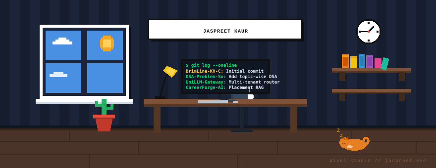
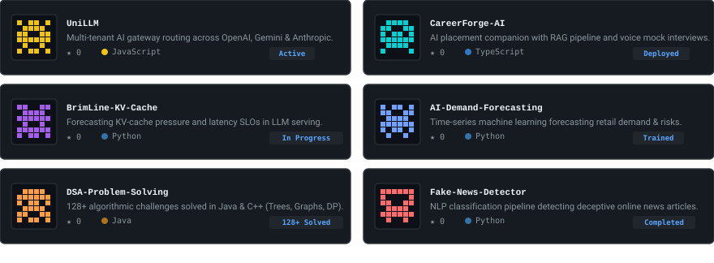
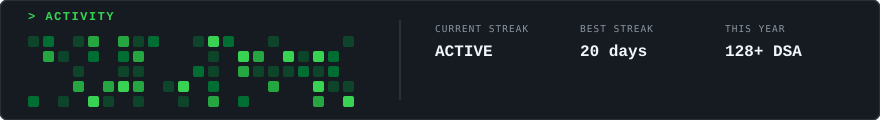
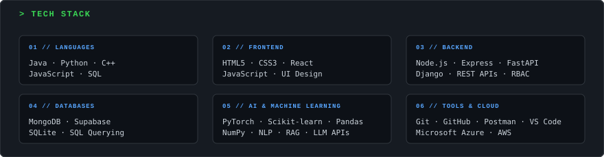
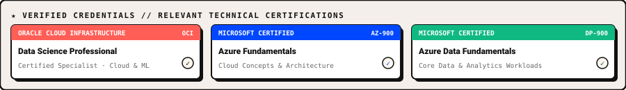

<!-- LOFI PIXEL ROOM BANNER -->

  The window shows the weather in Rajpura ,Punjab right now. The monitor scrolls my latest commits; the shelf holds a book for each language I write.

 

<!-- ABOUT CARD -->

  

<!-- PIXEL STATS BAR -->

 

---

### `> PROJECTS`

  

 

<b>[VIEW REPOSITORY DIRECTORY &amp; TECHNICAL HIGHLIGHTS]</b>

 

| Repository | Tech Stack | Status / Highlight | Link |
| :--- | :--- | :--- | :---: |
| **UniLLM** | `Node.js` · `Express` · `MongoDB` · `Socket.IO` · `JWT` | Multi-tenant AI gateway routing requests across OpenAI, Gemini &amp; Anthropic with streaming &amp; RBAC | [📦 Code](https://github.com/jaspreetxkaur/UniLLM) |
| **CareerForge-AI** | `Python` · `Azure OpenAI` · `Azure AI Speech` · `RAG` | AI-powered placement companion featuring resume scoring, placement RAG &amp; voice mock interviews | [📦 Code](https://github.com/jaspreetxkaur/CareerForge-AI) · [🚀 Demo](https://career-forge-ai-navy.vercel.app/) |
| **BrimLine — KV-Cache** | `Python` · `Deep Learning` · `PyTorch` | Forecasting KV-cache memory pressure and latency SLO violations in LLM inference serving | [📦 Code](https://github.com/jaspreetxkaur/BrimLine--KV-Cache-forecast) `[In Progress]` |
| **AI Demand Forecasting** | `Python` · `XGBoost` · `Random Forest` · `Pandas` · `Scikit-learn` | Time-series ML system predicting retail product demand curves and stockout/overstocking risks | [📦 Code](https://github.com/jaspreetxkaur/AI-powered-Demand-Forecasting-Model) |
| **DSA-Problem-Solving** | `Java` · `C++` · `Algorithms` | 128+ LeetCode problems solved with focus on Trees, Graphs, Recursion &amp; Dynamic Programming | [📦 Code](https://github.com/jaspreetxkaur/DSA-Problem-Solving) |
| **Fake News Detector** | `Python` · `Scikit-learn` · `NLP` · `NLTK` | Natural language processing pipeline classifying and detecting deceptive online articles | [📦 Code](https://github.com/jaspreetxkaur/AI-Powered-Fake-News-Detector) |
| **Netflix Data Analysis** | `Python` · `Pandas` · `Matplotlib` · `Jupyter` | Exploratory data analysis uncovering global content trends, genre distributions &amp; release cycles | [📦 Code](https://github.com/jaspreetxkaur/Netflix-Data-Analysis) |

 

---

### `> ACTIVITY`

  

 

---

### `> TECH STACK`

  

 

---

### `> CERTIFICATIONS`

  

 

* **Oracle Cloud Infrastructure (OCI)** — *Data Science Certified Professional*
* **Microsoft Certified** — *Azure Fundamentals (AZ-900)*
* **Microsoft Certified** — *Azure Data Fundamentals (DP-900)*

 

---

### `> CONNECT`

  

 

  <a href="https://github.com/jaspreetxkaur"><kbd>&nbsp;🌐&nbsp; GitHub : @jaspreetxkaur &nbsp;</kbd></a>&nbsp;&nbsp;&nbsp;&nbsp;
  <a href="https://linkedin.com/in/jaspreet-kaur-aiml-engineer"><kbd>&nbsp;💼&nbsp; LinkedIn : Jaspreet Kaur &nbsp;</kbd></a>&nbsp;&nbsp;&nbsp;&nbsp;
  <a href="mailto:jaspreet2775.beai24@chitkara.edu.in"><kbd>&nbsp;✉️&nbsp; Email : jaspreet2775.beai24@chitkara.edu.in &nbsp;</kbd></a>

 

  <code>Pixel Studio • JASPREET.exe // CHITKARA COHORT 2028 // ALWAYS BUILDING</code>

