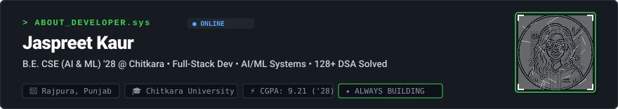
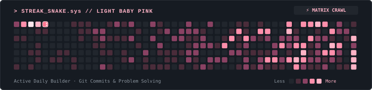

<!-- ANIMATED LOFI PIXEL ROOM (ALIGNED DESK, LAMP TOGGLE, WALKING CAT, SCROLLING CODE) -->

  

<!-- ANIMATED TYPING BANNER -->

  The window shows the weather in Rajpura, Punjab right now. The monitor scrolls my latest commits; the shelf holds a book for each language I write.

 

<!-- RETRO DEVELOPER IDENTITY CARD (FAST SCRATCH REVEAL AVATAR) -->

  

<!-- RETRO STATS HUD -->

 

---

### `> ACTIVITY & DAILY STREAK`

<!-- ANIMATED STREAK SNAKE IN LIGHT BABY PINK (FULL MATRIX CRAWL) -->

  

<!-- EXPANDED TALLER DAILY ACTIVITY PULSE GRAPH (LIGHT BABY PINK) -->

  

<!-- COMPACT LIVE GITHUB STREAK STATS (LIGHT BABY PINK THEME) -->

 

---

### `> FEATURED REPOSITORIES`

  <!-- 2-COLUMN RETRO PIXEL PROJECT CARDS WITH CLICKABLE REPO LINKS -->
  

 

<b>🌸 [VIEW ALL 8 VERIFIED REPOSITORIES &amp; DEMOS]</b>

 

| Repository | Domain &amp; Stack | Architecture &amp; Highlights | Action |
| :--- | :--- | :--- | :---: |
| <a href="https://github.com/jaspreetxkaur/UniLLM"><b>UniLLM</b></a> | `AI Gateway` · `Node` · `MongoDB` | Multi-tenant AI router across OpenAI, Gemini &amp; Anthropic with streaming &amp; RBAC | <a href="https://github.com/jaspreetxkaur/UniLLM">📦 View Code</a> |
| <a href="https://github.com/jaspreetxkaur/CareerForge-AI"><b>CareerForge-AI</b></a> | `Speech AI` · `Python` · `Azure AI` · `RAG` | AI placement companion with automated resume scoring, placement RAG &amp; voice interviews | <a href="https://github.com/jaspreetxkaur/CareerForge-AI">📦 Code</a> · <a href="https://career-forge-ai-navy.vercel.app/">🚀 Demo</a> |
| <a href="https://github.com/jaspreetxkaur/BrimLine--KV-Cache-forecast"><b>BrimLine — KV-Cache</b></a> | `Deep Learning` · `PyTorch` · `DNNs` | Forecasting KV-cache memory pressure and latency SLO violations in LLM serving | <a href="https://github.com/jaspreetxkaur/BrimLine--KV-Cache-forecast">⚡ View Code</a> |
| <a href="https://github.com/jaspreetxkaur/AI-powered-Demand-Forecasting-Model"><b>AI Demand Forecasting</b></a> | `ML Systems` · `XGBoost` · `Pandas` | Time-series ML system forecasting retail demand curves and predicting stockout risks | <a href="https://github.com/jaspreetxkaur/AI-powered-Demand-Forecasting-Model">📦 View Code</a> |
| <a href="https://github.com/jaspreetxkaur/DSA-Problem-Solving"><b>DSA-Problem-Solving</b></a> | `Algorithms` · `Java` · `C++` | 128+ algorithmic challenges solved with clean implementations in Trees, Graphs &amp; DP | <a href="https://github.com/jaspreetxkaur/DSA-Problem-Solving">🌲 128+ Solved</a> |
| <a href="https://github.com/jaspreetxkaur/AI-Powered-Fake-News-Detector"><b>Fake News Detector</b></a> | `NLP` · `Python` · `Scikit-learn` | Natural language processing pipeline classifying and detecting deceptive online articles | <a href="https://github.com/jaspreetxkaur/AI-Powered-Fake-News-Detector">📦 View Code</a> |
| <a href="https://github.com/jaspreetxkaur/Netflix-Data-Analysis"><b>Netflix Data Analysis</b></a> | `Data Science` · `Python` · `Pandas` | Exploratory data analysis uncovering global content trends, genre distributions &amp; release cycles | <a href="https://github.com/jaspreetxkaur/Netflix-Data-Analysis">📊 Insights</a> |
| <a href="https://github.com/jaspreetxkaur/Allora---The-essence-of-chic"><b>Allora Fashion Web</b></a> | `Frontend Web` · `HTML5` · `CSS3` | Clean, responsive modern web design and editorial user interface | <a href="https://github.com/jaspreetxkaur/Allora---The-essence-of-chic">✨ View Code</a> |

 

---

### `> SKILLS & TOOLS`

  <!-- CLEAN PURE ICONS SHELF (NO CLUTTER, NO EMPTY BOXES) -->
  

 

---

### `> COLLECTOR'S SHOWCASE & ACHIEVEMENTS`

  <!-- CUTE PIXEL TROPHIES SHOWCASE -->
  

 

---

### `> ATELIER MAILBOX`

  <!-- CUTE ATELIER DESK CONNECT -->
  

 

  <code>Pixel Studio • JASPREET // CHITKARA COHORT 2028 // ALWAYS BUILDING ✨</code>

