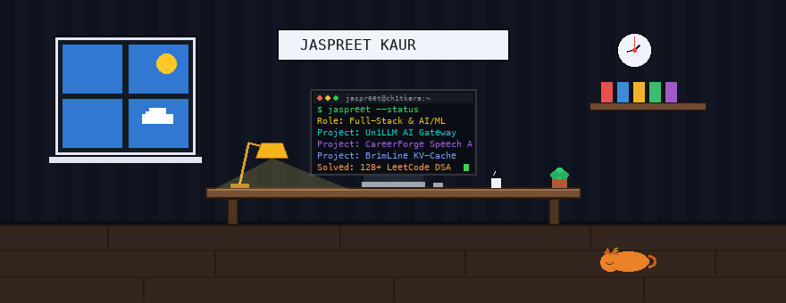
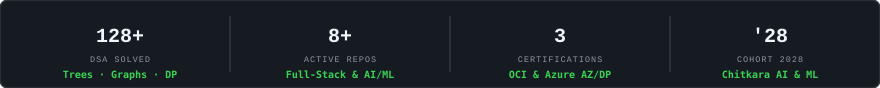
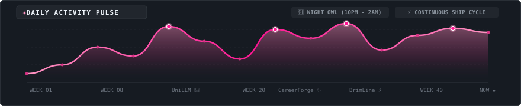
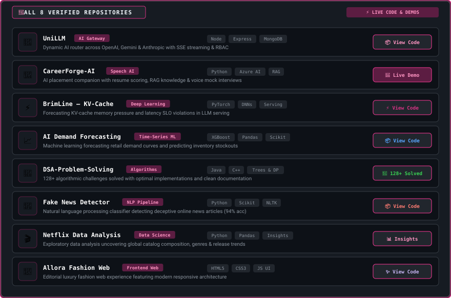
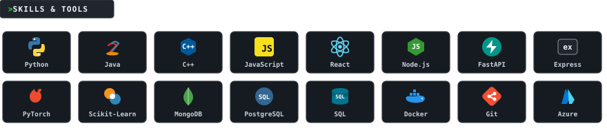
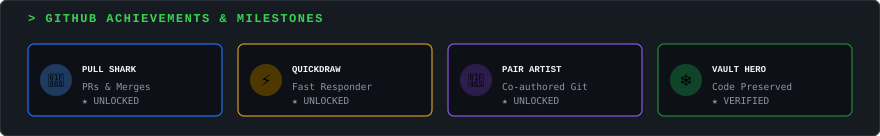

<!-- ANIMATED LOFI PIXEL ROOM (ALIGNED DESK, LAMP TOGGLE, WALKING CAT, SCROLLING CODE) -->

  

<!-- ANIMATED TYPING BANNER -->

  The window shows the weather in Rajpura, Punjab right now. The monitor scrolls my latest commits; the shelf holds a book for each language I write.

 

<!-- RETRO DEVELOPER IDENTITY CARD (FAST SCRATCH REVEAL AVATAR) -->

  

<!-- RETRO STATS HUD -->

 

---

### `> ACTIVITY & DAILY STREAK`

<!-- ANIMATED STREAK SNAKE IN BABY PINK & DARK PINK (FULL MATRIX CRAWL) -->

  

<!-- HORIZONTAL DAILY ACTIVITY PULSE GRAPH -->

  

<!-- HORIZONTAL LIVE GITHUB STREAK STATS -->

 

---

### `> FEATURED REPOSITORIES`

  <!-- 2-COLUMN RETRO PIXEL PROJECT CARDS WITH CLICKABLE REPO LINKS -->
  

 

<!-- INNOVATIVE REPOSITORY ARCHIVE WITH AESTHETIC PINK BORDER (LIKE CONTRIBUTION MATRIX) -->

<kbd>&nbsp;🌸&nbsp; [ATELIER VAULT // ALL 8 VERIFIED REPOSITORIES &amp; DEMOS] &nbsp;</kbd>

 

  

 

---

### `> SKILLS & TOOLS`

  <!-- CLEAN PURE ICONS SHELF (NO CLUTTER, NO EMPTY BOXES) -->
  

 

---

### `> COLLECTOR'S SHOWCASE & ACHIEVEMENTS`

  <!-- CUTE PIXEL TROPHIES SHOWCASE -->
  

 

---

### `> ATELIER MAILBOX`

  <!-- CUTE ATELIER DESK CONNECT -->
  

 

  <code>Pixel Studio • JASPREET // CHITKARA COHORT 2028 // ALWAYS BUILDING ✨</code>

