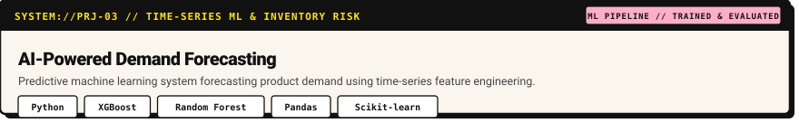
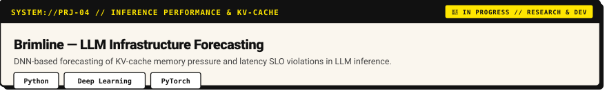
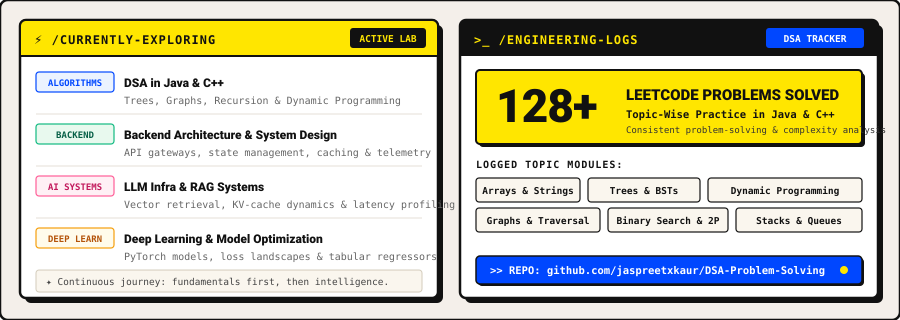

<!-- HERO BANNER: RETRO DIGITAL × NEO-BRUTALISM (JASPREET.exe) -->

 

### `> 01 // ABOUT`

> **"I build intelligent applications, engineer backend systems, and turn ideas into working software."**

I am a Computer Science & Engineering student specializing in **Artificial Intelligence & Machine Learning** at **Chitkara University** (Class of 2028 · CGPA: 9.21). My development focus combines modern full-stack development, backend API architectures, and intelligent systems powered by AI/ML and LLMs.

I believe in **learning by building real software**—understanding distributed data flows, schema design, latency trade-offs, and deployment pipelines rather than just memorizing syntax. When I am not pushing code to production, I explore deep neural networks, evaluate LLM inference infrastructure, and refine algorithmic problem-solving.

 

---

### `> 02 // TECH ARSENAL`

  <!-- CUSTOM SVG VISUAL ARCHITECTURE FOR TECH STACK -->
  

 

#### `// VERIFIED TOOLS & TECHNOLOGIES`

| Category | Primary Technologies & Stacks |
| :--- | :--- |
| **Programming Languages** | `Java` · `Python` · `C++` · `JavaScript` · `SQL` · `HTML5` · `CSS3` |
| **Frontend Engineering** | `React` · `JavaScript (ES6+)` · `HTML5` · `CSS3` · `Responsive UI Design` · `Component Architecture` |
| **Backend & APIs** | `Node.js` · `Express.js` · `FastAPI` · `Django` · `REST APIs` · `Socket.IO` · `JWT Authentication` |
| **Databases & Storage** | `MongoDB` · `SQLite` · `Supabase` · `SQL` · `Aggregation Pipelines` · `Schema Indexing` |
| **AI / Machine Learning** | `PyTorch` · `Scikit-learn` · `Pandas` · `NumPy` · `Deep Neural Networks` · `NLP` · `RAG` · `LLM APIs` |
| **Cloud & Developer Tools** | `Microsoft Azure` · `AWS` · `Git` · `GitHub` · `VS Code` · `Postman` · `Vercel` · `Render` |

 

<!-- RECOGNIZABLE ICON BADGE MATRIX -->

  &nbsp;
  &nbsp;
  &nbsp;
  &nbsp;
  &nbsp;
  &nbsp;
  

  &nbsp;
  &nbsp;
  &nbsp;
  &nbsp;
  &nbsp;
  &nbsp;
  

 

---

### `> 03 // FEATURED ENGINEERING WORK`

  

 

<!-- PROJECT 01: UNILLM -->

**`PROJECT 01: UniLLM`** &nbsp;·&nbsp; `AI Infrastructure & Backend Engineering`  
*A multi-tenant AI inference gateway exposing an OpenAI-compatible API to dynamically route inference requests across OpenAI, Gemini, and Anthropic.*

- **Provider Adapter Architecture:** Modular adapter design providing uniform request/response translation across heterogeneous LLM providers.
- **Resilience & Streaming:** Configurable fallback chains, automatic retry logic, standard JSON responses, and Server-Sent Events (SSE) streaming.
- **Performance & Caching:** In-memory TTL/LRU response caching reducing duplicate inference latency and upstream cost.
- **Enterprise Security:** Virtual API keys with SHA-256 hashing, JWT cookie-backed sessions, scrypt password hashing, and role-based access control (RBAC).
- **Observability:** Organization and workspace management, server-side budget limits, audit logging, and real-time usage analytics via MongoDB aggregation pipelines & Socket.IO.
- **Tech Stack:** `Node.js` · `Express.js` · `MongoDB` · `Socket.IO` · `JWT` · `REST API`
- **Source Code:** [📦 github.com/jaspreetxkaur/UniLLM](https://github.com/jaspreetxkaur/UniLLM)

 

<!-- PROJECT 02: CAREERFORGE AI -->

**`PROJECT 02: CareerForge AI`** &nbsp;·&nbsp; `AI Application & Full Stack Development`  
*An intelligent placement and career companion combining automated resume analysis, readiness scoring, personalized roadmaps, and multimodal mock interviews.*

- **Azure AI Multimodal Pipeline:** Deep integration of Azure OpenAI and Azure AI Speech services for realistic conversational interview simulations.
- **Interview Analysis Engine:** Camera and microphone-driven evaluation measuring speaking pace, filler-word frequency, and pause latency.
- **Placement RAG Pipeline:** Context-aware placement assistant answering student queries using domain-specific campus recruitment data.
- **Clean Architecture:** Modular service layer separating speech ingestion, RAG retrieval, scoring heuristics, and UI communication.
- **Tech Stack:** `Python` · `Azure OpenAI` · `Azure AI Speech` · `RAG` · `REST API` · `Vercel`
- **Source Code:** [📦 github.com/jaspreetxkaur/CareerForge-AI](https://github.com/jaspreetxkaur/CareerForge-AI)
- **Live Deployment:** [🚀 career-forge-ai-navy.vercel.app](https://career-forge-ai-navy.vercel.app/)

 

<!-- PROJECT 03: DEMAND FORECASTING SYSTEM -->

**`PROJECT 03: Demand Forecasting System`** &nbsp;·&nbsp; `Machine Learning & Predictive Analytics`  
*A machine learning time-series forecasting system trained on a 10-year weekly dataset spanning 6 cities, 20 categories, and 100 SKUs.*

- **Feature Engineering:** Built rolling lag features, multi-window moving averages, volatility indicators, and spike detection algorithms.
- **Calendar & Event Features:** Incorporated India-specific festive and holiday calendars to capture seasonal demand surges.
- **Risk Scoring Heuristic:** Product-city-week inventory analysis computing quantitative stockout and overstock risk probabilities.
- **Models Evaluated:** Gradient boosting (XGBoost) and ensemble Random Forests cross-validated across temporal split horizons.
- **Tech Stack:** `Python` · `XGBoost` · `Random Forest` · `Pandas` · `Scikit-learn` · `NumPy`
- **Source Code:** [📦 github.com/jaspreetxkaur/AI-powered-Demand-Forecasting-Model](https://github.com/jaspreetxkaur/AI-powered-Demand-Forecasting-Model)

 

<!-- PROJECT 04: BRIMLINE -->

**`PROJECT 04: Brimline`** &nbsp;·&nbsp; `Deep Learning & LLM Infrastructure` &nbsp;·&nbsp; `[STATUS: IN PROGRESS]`  
*Ongoing research engineering exploring deep neural network forecasting of GPU KV-cache memory pressure and latency SLO violations during LLM inference.*

- **Workload Simulation:** Custom Python-based workload harness simulating multi-tenant token generation cycles and variable prompt lengths.
- **Telemetry Ingestion:** Real-time metrics tracking input/output tokens, queries per second (QPS), and instantaneous GPU memory utilization.
- **Predictive Goal:** Train compact DNN models to predict KV-cache memory saturation ahead of time to prevent out-of-memory eviction and tail latency spikes.
- **Tech Stack:** `Python` · `PyTorch` · `Deep Neural Networks` · `Time-Series Modeling`
- **Source Code:** [📦 github.com/jaspreetxkaur/BrimLine--KV-Cache-forecast](https://github.com/jaspreetxkaur/BrimLine--KV-Cache-forecast)

 

---

### `> 04 // OPEN-SOURCE & REPOSITORY MATRIX`

A verified overview of public engineering repositories maintained on GitHub:

| Repository | Primary Domain | Core Stack | Description | Status / Link |
| :--- | :--- | :--- | :--- | :---: |
| [**CareerForge-AI**](https://github.com/jaspreetxkaur/CareerForge-AI) | Full-Stack AI | `Python` · `Azure OpenAI` · `RAG` | AI placement preparation suite with mock interviews & resume analysis | [🚀 Code + Live Demo](https://career-forge-ai-navy.vercel.app/) |
| [**UniLLM**](https://github.com/jaspreetxkaur/UniLLM) | Backend / Infra | `Node.js` · `Express` · `MongoDB` | Multi-tenant LLM router across OpenAI, Gemini & Anthropic | [📦 View Repository](https://github.com/jaspreetxkaur/UniLLM) |
| [**BrimLine**](https://github.com/jaspreetxkaur/BrimLine--KV-Cache-forecast) | Deep Learning | `Python` · `PyTorch` · `DNN` | Forecasting GPU KV-cache pressure and latency SLO violations | [⚡ View Repository](https://github.com/jaspreetxkaur/BrimLine--KV-Cache-forecast) |
| [**Demand Forecasting**](https://github.com/jaspreetxkaur/AI-powered-Demand-Forecasting-Model) | Machine Learning | `Python` · `XGBoost` · `Scikit-learn` | 10-year multi-city retail demand and stockout risk prediction model | [📦 View Repository](https://github.com/jaspreetxkaur/AI-powered-Demand-Forecasting-Model) |
| [**DSA-Problem-Solving**](https://github.com/jaspreetxkaur/DSA-Problem-Solving) | Algorithms | `Java` · `C++` · `Data Structures` | 128+ verified algorithmic solutions in Trees, Graphs, DP & Heaps | [📦 View Repository](https://github.com/jaspreetxkaur/DSA-Problem-Solving) |
| [**Fake News Detector**](https://github.com/jaspreetxkaur/AI-Powered-Fake-News-Detector) | NLP / ML | `Python` · `Scikit-learn` · `NLTK` | Text classification pipeline identifying deceptive online articles | [📦 View Repository](https://github.com/jaspreetxkaur/AI-Powered-Fake-News-Detector) |
| [**Netflix Data Analysis**](https://github.com/jaspreetxkaur/Netflix-Data-Analysis) | Data Science | `Python` · `Pandas` · `Matplotlib` | Exploratory data analysis on catalog composition and regional releases | [📦 View Repository](https://github.com/jaspreetxkaur/Netflix-Data-Analysis) |
| [**Allora Fashion Web**](https://github.com/jaspreetxkaur/Allora---The-essence-of-chic) | Frontend Web | `HTML5` · `CSS3` · `JavaScript` | Clean, responsive modern web design and editorial user interface | [📦 View Repository](https://github.com/jaspreetxkaur/Allora---The-essence-of-chic) |

 

---

### `> 05 // GITHUB ACTIVITY & STREAK TELEMETRY`

<!-- LIVE STREAK STATS (QUERIES GITHUB DIRECTLY) -->

  

<!-- GITHUB STATS OVERVIEW -->

 

---

### `> 06 // CURRENTLY EXPLORING & ENGINEERING LOGS`

  <!-- DUAL PANEL: CURRENTLY EXPLORING + DSA LOGS -->
  

- **Currently Researching & Building:**
  - Exploring distributed AI gateway architectures and multi-tenant rate limiting.
  - Investigating KV-cache memory pressure and latency SLO bounds in LLM inference servers.
  - Designing low-latency retrieval pipelines using vector indexing and reranking heuristics.
- **Algorithmic Problem Solving:**
  - 128+ algorithmic challenges solved on LeetCode with structured implementations in Java.
  - Core areas practiced: Binary Search Trees, Graph Traversals (BFS/DFS), Dynamic Programming, and Two Pointers.
  - Documented in the [DSA-Problem-Solving](https://github.com/jaspreetxkaur/DSA-Problem-Solving) repository.

 

---

### `> 07 // VERIFIED CREDENTIALS`

  <!-- CERTIFICATION CARDS -->
  

 

---

### `> 08 // CONNECT & COLLABORATE`

  

 

  &nbsp;&nbsp;&nbsp;&nbsp;
  &nbsp;&nbsp;&nbsp;&nbsp;
  

 

  <code>JASPREET.exe // CHITKARA UNIVERSITY · COHORT 2028 // SYSTEM STATUS: ALWAYS BUILDING</code>

