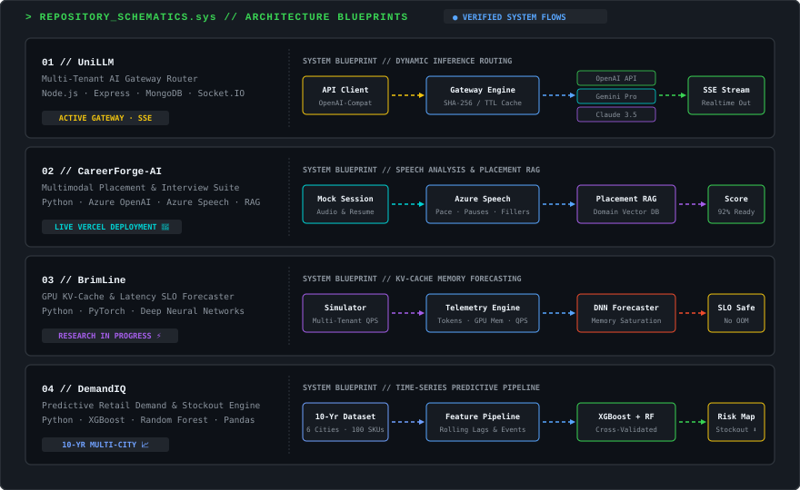
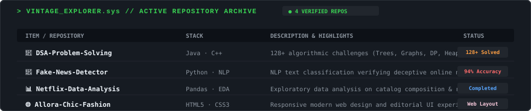
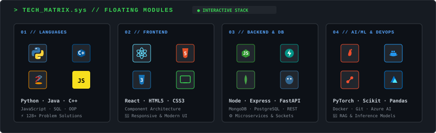

<!-- ANIMATED LOFI PIXEL ROOM (ALIGNED DESK, LAMP TOGGLE, WALKING CAT, SCROLLING CODE) -->

  

<!-- ANIMATED TYPING HEADER -->

  The window shows the weather in Rajpura, Punjab right now. The monitor scrolls my latest commits; the shelf holds a book for each language I write.

 

<!-- RETRO DEVELOPER PASSPORT / ABOUT CARD (WITH FAST SCRATCH REVEAL AVATAR) -->

  

<!-- RETRO ARCADE STATS HUD -->

 

---

### `> ACTIVITY & DAILY STREAK`

<!-- FAST STREAK SNAKE (BABY PINK & DARK PINK) -->

  

<!-- LIVE GITHUB ACTIVITY STREAK GRAPH (BABY PINK & DARK PINK ACCENTS) -->

 

---

### `> FEATURED ARCHITECTURES & SCHEMATICS`

  <!-- INTERACTIVE ARCHITECTURE BLUEPRINTS (FLOWCHARTS & SCHEMATICS) -->
  

 

  <!-- VINTAGE FILE EXPLORER ARCHIVE FOR SUPPORTING REPOSITORIES -->
  

 

<b>[VIEW ALL 8 VERIFIED REPOSITORY REPOSITORIES &amp; DEMOS]</b>

 

| Repository | Domain &amp; Stack | Architecture &amp; Highlights | Action |
| :--- | :--- | :--- | :---: |
| [**UniLLM**](https://github.com/jaspreetxkaur/UniLLM) | `AI Gateway` · `Node` · `Express` · `MongoDB` | Multi-tenant AI router across OpenAI, Gemini &amp; Anthropic with streaming &amp; RBAC | [📦 View Code](https://github.com/jaspreetxkaur/UniLLM) |
| [**CareerForge-AI**](https://github.com/jaspreetxkaur/CareerForge-AI) | `AI Application` · `Python` · `Azure AI` · `RAG` | AI placement companion with automated resume scoring, placement RAG &amp; voice interviews | [📦 Code](https://github.com/jaspreetxkaur/CareerForge-AI) · [🚀 Live Demo](https://career-forge-ai-navy.vercel.app/) |
| [**BrimLine — KV-Cache**](https://github.com/jaspreetxkaur/BrimLine--KV-Cache-forecast) | `Deep Learning` · `PyTorch` · `DNNs` | Forecasting KV-cache memory pressure and latency SLO violations in LLM serving | [⚡ View Code](https://github.com/jaspreetxkaur/BrimLine--KV-Cache-forecast) `[In Progress]` |
| [**AI Demand Forecasting**](https://github.com/jaspreetxkaur/AI-powered-Demand-Forecasting-Model) | `Machine Learning` · `XGBoost` · `Pandas` | Time-series ML system forecasting retail demand curves and predicting stockout risks | [📦 View Code](https://github.com/jaspreetxkaur/AI-powered-Demand-Forecasting-Model) |
| [**DSA-Problem-Solving**](https://github.com/jaspreetxkaur/DSA-Problem-Solving) | `Algorithms` · `Java` · `C++` | Comprehensive algorithmic problem-solving repository with clean solutions in Trees, Graphs &amp; DP | [📦 View Code](https://github.com/jaspreetxkaur/DSA-Problem-Solving) |
| [**Fake News Detector**](https://github.com/jaspreetxkaur/AI-Powered-Fake-News-Detector) | `NLP` · `Python` · `Scikit-learn` | Natural language processing pipeline classifying and detecting deceptive online articles | [📦 View Code](https://github.com/jaspreetxkaur/AI-Powered-Fake-News-Detector) |
| [**Netflix Data Analysis**](https://github.com/jaspreetxkaur/Netflix-Data-Analysis) | `Data Science` · `Python` · `Pandas` | Exploratory data analysis uncovering global content trends, genre distributions &amp; release cycles | [📦 View Code](https://github.com/jaspreetxkaur/Netflix-Data-Analysis) |
| [**Allora Fashion Web**](https://github.com/jaspreetxkaur/Allora---The-essence-of-chic) | `Frontend Web` · `HTML5` · `CSS3` · `JS` | Clean, responsive modern web design and editorial user interface | [📦 View Code](https://github.com/jaspreetxkaur/Allora---The-essence-of-chic) |

 

---

### `> TECH STACK & FLOATING MODULES`

  <!-- FLOATING ICONS MATRIX (ICONS DRIFTING SLOWLY IN BOXES) -->
  

 

  &nbsp;
  &nbsp;
  &nbsp;
  &nbsp;
  &nbsp;
  &nbsp;
  

  &nbsp;
  &nbsp;
  &nbsp;
  &nbsp;
  &nbsp;
  &nbsp;
  

 

---

### `> GITHUB ACHIEVEMENTS & MILESTONES`

  <!-- CLEAN METALLIC TROPHY SHELF (NO GREEN GRADIENT) -->
  

 

---

### `> CONNECT`

  

 

  <a href="https://github.com/jaspreetxkaur"><kbd>&nbsp;🌐&nbsp; GitHub : @jaspreetxkaur &nbsp;</kbd></a>&nbsp;&nbsp;&nbsp;&nbsp;
  <a href="https://linkedin.com/in/jaspreet-kaur-aiml-engineer"><kbd>&nbsp;💼&nbsp; LinkedIn : Jaspreet Kaur &nbsp;</kbd></a>&nbsp;&nbsp;&nbsp;&nbsp;
  <a href="mailto:jaspreet2775.beai24@chitkara.edu.in"><kbd>&nbsp;✉️&nbsp; Email : jaspreet2775.beai24@chitkara.edu.in &nbsp;</kbd></a>

 

  <code>Pixel Studio • JASPREET // CHITKARA COHORT 2028 // ALWAYS BUILDING</code>

