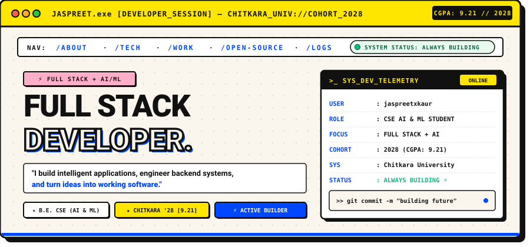
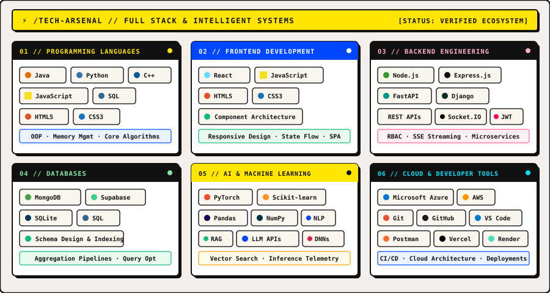
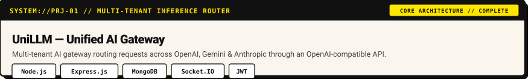
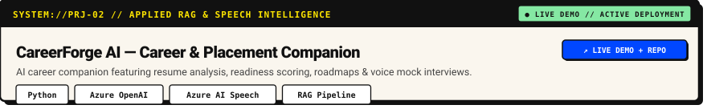

<!-- HERO SECTION: RETRO DIGITAL × NEO-BRUTALISM -->

  

<!-- SUBTLE NEO-BRUTALIST QUICK-JUMP BAR -->

  <a href="#about"><kbd>&nbsp;✦&nbsp; /ABOUT &nbsp;</kbd></a>&nbsp;&nbsp;
  <a href="#tech-stack"><kbd>&nbsp;⚡&nbsp; /STACK &nbsp;</kbd></a>&nbsp;&nbsp;
  <a href="#featured-projects"><kbd>&nbsp;🛠️&nbsp; /WORK &nbsp;</kbd></a>&nbsp;&nbsp;
  <a href="#currently-exploring--engineering-logs"><kbd>&nbsp;📈&nbsp; /LOGS &nbsp;</kbd></a>&nbsp;&nbsp;
  <a href="#certifications"><kbd>&nbsp;★&nbsp; /CERTS &nbsp;</kbd></a>&nbsp;&nbsp;
  <a href="#connect"><kbd>&nbsp;📬&nbsp; /CONNECT &nbsp;</kbd></a>

 

---

### `01` // ABOUT ME

Hey, I'm **Jaspreet** — a Computer Science and Engineering student specializing in **Artificial Intelligence & Machine Learning** at **Chitkara University** (Class of 2028).

I enjoy building full-stack applications, digging into backend engineering, experimenting with AI/ML systems, and solving problems through clean code.

Rather than looking at software from just one angle, I like connecting the dots between solid software engineering foundations and intelligent architectures:

* **Full-Stack Development** — Designing clean, responsive user experiences connected to well-structured server backends.
* **Backend Engineering** — Building REST APIs, authentication flows (JWT & RBAC), caching strategies, and data models.
* **Artificial Intelligence & Machine Learning** — Training predictive models, exploring deep neural networks, and developing data pipelines.
* **Large Language Models & RAG** — Building multi-provider gateways, vector-based retrieval pipelines, and agentic workflows.
* **Data Structures & Algorithms** — Practicing computational problem-solving in Java and C++ with rigorous complexity analysis.
* **System Design** — Exploring distributed systems, streaming protocols, telemetry, and fault-tolerant architectures.

---

### `02` // TECH STACK MATRIX

  

 

<b>&gt; [EXPAND RAW TECH STACK INVENTORY]</b>

 

| Domain | Technologies &amp; Frameworks |
| :--- | :--- |
| **Languages** | `Java` · `Python` · `C++` · `JavaScript` · `SQL` |
| **Frontend** | `HTML` · `CSS` · `JavaScript` · `React` |
| **Backend** | `Node.js` · `Express.js` · `FastAPI` · `Django` · `REST APIs` |
| **Databases** | `MongoDB` · `SQLite` · `Supabase` · `SQL` |
| **AI &amp; Machine Learning** | `Machine Learning` · `Deep Neural Networks` · `Scikit-learn` · `Pandas` · `NumPy` · `NLP` · `RAG` · `LLM API Integration` |
| **Tools &amp; Cloud** | `Git` · `GitHub` · `Postman` · `VS Code` · `Microsoft Azure` · `AWS Fundamentals` |

---

### `03` // FEATURED PROJECTS

  

 

#### 1. UniLLM — Unified AI Gateway

  

> **Stack:** `Node.js` · `Express.js` · `MongoDB` · `Socket.IO` · `JWT`

A multi-tenant AI gateway that routes requests dynamically across OpenAI, Gemini, and Anthropic through an OpenAI-compatible API.

* **Provider Routing &amp; Fallback:** Automatically redirects requests across models to ensure high availability and prevent downtime.
* **Streaming API Support:** Native chunked streaming responses for low-latency interactive consumer interfaces.
* **Virtual API Keys &amp; RBAC:** Isolated tenant keys with granular role-based access control, token quotas, and budget caps.
* **Budget Enforcement &amp; Audit Logging:** Enforces per-tenant spending limits and maintains an auditable request ledger.
* **Real-Time Analytics &amp; Response Caching:** Built-in latency telemetry and intelligent response caching to cut redundant API overhead.

---

#### 2. CareerForge AI — Placement &amp; Career Companion

  

  <a href="https://github.com/jaspreetxkaur/CareerForge-AI"><kbd>&nbsp;📦&nbsp; GitHub Repository &nbsp;</kbd></a>&nbsp;&nbsp;&nbsp;&nbsp;
  <a href="https://career-forge-ai-navy.vercel.app/"><kbd>&nbsp;🚀&nbsp; Live Application &nbsp;</kbd></a>

> **Stack:** `Python` · `Azure OpenAI` · `Azure AI Speech` · `RAG`

An AI-powered career and placement companion featuring resume analysis, career-readiness scoring, preparation roadmaps, mock interviews, and a placement RAG pipeline.

* **Placement Knowledge RAG Pipeline:** Domain-specific retrieval indexing campus recruitment archives, technical question banks, and syllabus roadmaps.
* **Interactive Voice Mock Interviews:** Real-time conversational interview simulations leveraging Azure AI Speech for natural audio evaluation.
* **Automated Resume Scoring:** Evaluates candidate profiles against industry benchmarks to generate readiness scores and tailored skill roadmaps.

---

#### 3. AI-Powered Demand Forecasting

  

> **Stack:** `Python` · `XGBoost` · `Random Forest` · `Pandas` · `Scikit-learn`

A machine learning system that forecasts product demand using time-series feature engineering and predicts inventory risks such as stockouts and overstocking.

* **Time-Series Feature Engineering:** Extracts lag features, rolling statistics, and seasonal patterns across transaction history.
* **Ensemble Learning Pipeline:** Trains and tunes XGBoost and Random Forest regressors for multi-horizon demand forecasting.
* **Inventory Risk Alerts:** Predicts probabilities of stockouts and excess holding to optimize warehouse buffer stock.

---

#### 4. Brimline — LLM Infrastructure Forecasting `[IN PROGRESS]`

  

> **Status:** `🚧 IN ACTIVE RESEARCH & DEVELOPMENT`  
> **Stack:** `Python` · `Deep Learning` · `PyTorch`

An ongoing project exploring DNN-based forecasting of KV-cache memory pressure and latency SLO violations in LLM inference systems.

* **KV-Cache Allocation Modeling:** Modeling how dynamic context windows and concurrent burst requests impact GPU vRAM pressure.
* **SLO Violation Forecasting:** Predictive modeling for Time-To-First-Token (TTFT) and inter-token generation latency spikes.
* **Scheduling Optimization:** Aimed at informing proactive GPU memory headroom management and request batching policies.

---

### `04` // CURRENTLY EXPLORING &amp; ENGINEERING LOGS

  

 

  <a href="https://github.com/jaspreetxkaur/DSA-Problem-Solving"><kbd>&nbsp;⚡&nbsp; Explore DSA Practice Repository : github.com/jaspreetxkaur/DSA-Problem-Solving &nbsp;</kbd></a>

* **Data Structures &amp; Algorithms:** Actively solving algorithmic challenges in **Java** and **C++** with a focus on Trees, Binary Search Trees, Graphs, Recursion, and Dynamic Programming.
* **Backend Systems:** Deep diving into system design fundamentals — concurrency, connection pooling, caching layers, and database sharding.
* **AI &amp; LLM Infrastructure:** Experimenting with vector databases, semantic caching, quantization, and GPU memory dynamics during inference.
* **Engineering Consistency:** 128+ problems solved with focus on time/space trade-offs and clean code implementations.

---

### `05` // VERIFIED TECHNICAL CREDENTIALS

  

 

* **Oracle Cloud Infrastructure (OCI)** — *Data Science Certified Professional*
* **Microsoft Certified** — *Azure Fundamentals (AZ-900)*
* **Microsoft Certified** — *Azure Data Fundamentals (DP-900)*

---

### `06` // LET'S CONNECT

  

 

  <a href="https://github.com/jaspreetxkaur"><kbd>&nbsp;🌐&nbsp; GitHub : @jaspreetxkaur &nbsp;</kbd></a>&nbsp;&nbsp;&nbsp;&nbsp;
  <a href="https://linkedin.com/in/jaspreet-kaur-aiml-engineer"><kbd>&nbsp;💼&nbsp; LinkedIn : Jaspreet Kaur &nbsp;</kbd></a>&nbsp;&nbsp;&nbsp;&nbsp;
  <a href="mailto:jaspreet2775.beai24@chitkara.edu.in"><kbd>&nbsp;✉️&nbsp; Email : jaspreet2775.beai24@chitkara.edu.in &nbsp;</kbd></a>

 

  <code>SYSTEM_ID: JASPREET.exe // COHORT 2028 // BUILT WITH INTENT &amp; CODE</code>

