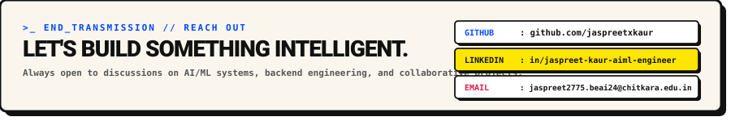

<!-- ANIMATED LOFI PIXEL ROOM (ALIGNED DESK, LAMP TOGGLE, WALKING CAT, SCROLLING CODE) -->

  

<!-- ANIMATED TYPING BANNER -->

  The window shows the weather in Rajpura, Punjab right now. The monitor scrolls my latest commits; the shelf holds a book for each language I write.

 

<!-- RETRO DEVELOPER IDENTITY CARD (FAST SCRATCH REVEAL AVATAR) -->

  

<!-- RETRO STATS HUD -->

 

---

### `> ACTIVITY & DAILY STREAK`

<!-- LIVE DYNAMIC GITHUB CONTRIBUTION SNAKE (AUTO-UPDATED BY GITHUB ACTIONS) -->
<a href="https://github.com/jaspreetxkaur">
  <picture>
    <source media="(prefers-color-scheme: dark)" srcset="https://raw.githubusercontent.com/jaspreetxkaur/jaspreetxkaur/output/github-contribution-grid-snake-dark.svg">
    <source media="(prefers-color-scheme: light)" srcset="https://raw.githubusercontent.com/jaspreetxkaur/jaspreetxkaur/output/github-contribution-grid-snake.svg">
    
  </picture>
</a>

  

<!-- LIVE GITHUB STREAK STATS (SOFT DUSTY ROSE THEME) -->

 

---

### `> FEATURED REPOSITORIES`

  <!-- 2-COLUMN RETRO PIXEL PROJECT CARDS WITH CLICKABLE REPO LINKS -->
  

 

<b>[VIEW ALL 8 VERIFIED REPOSITORIES &amp; DEMOS]</b>

 

| Repository | Domain &amp; Stack | Architecture &amp; Highlights | Action |
| :--- | :--- | :--- | :---: |
| [**UniLLM**](https://github.com/jaspreetxkaur/UniLLM) | `AI Gateway` · `Node` · `Express` · `MongoDB` | Multi-tenant AI router across OpenAI, Gemini &amp; Anthropic with streaming &amp; RBAC | [📦 View Code](https://github.com/jaspreetxkaur/UniLLM) |
| [**CareerForge-AI**](https://github.com/jaspreetxkaur/CareerForge-AI) | `AI Application` · `Python` · `Azure AI` · `RAG` | AI placement companion with automated resume scoring, placement RAG &amp; voice interviews | [📦 Code](https://github.com/jaspreetxkaur/CareerForge-AI) · [🚀 Live Demo](https://career-forge-ai-navy.vercel.app/) |
| [**BrimLine — KV-Cache**](https://github.com/jaspreetxkaur/BrimLine--KV-Cache-forecast) | `Deep Learning` · `PyTorch` · `DNNs` | Forecasting KV-cache memory pressure and latency SLO violations in LLM serving | [⚡ View Code](https://github.com/jaspreetxkaur/BrimLine--KV-Cache-forecast) `[In Progress]` |
| [**AI Demand Forecasting**](https://github.com/jaspreetxkaur/AI-powered-Demand-Forecasting-Model) | `Machine Learning` · `XGBoost` · `Pandas` | Time-series ML system forecasting retail demand curves and predicting stockout risks | [📦 View Code](https://github.com/jaspreetxkaur/AI-powered-Demand-Forecasting-Model) |
| [**DSA-Problem-Solving**](https://github.com/jaspreetxkaur/DSA-Problem-Solving) | `Algorithms` · `Java` · `C++` | Comprehensive algorithmic problem-solving repository with clean solutions in Trees, Graphs &amp; DP | [📦 View Code](https://github.com/jaspreetxkaur/DSA-Problem-Solving) |
| [**Fake News Detector**](https://github.com/jaspreetxkaur/AI-Powered-Fake-News-Detector) | `NLP` · `Python` · `Scikit-learn` | Natural language processing pipeline classifying and detecting deceptive online articles | [📦 View Code](https://github.com/jaspreetxkaur/AI-Powered-Fake-News-Detector) |
| [**Netflix Data Analysis**](https://github.com/jaspreetxkaur/Netflix-Data-Analysis) | `Data Science` · `Python` · `Pandas` | Exploratory data analysis uncovering global content trends, genre distributions &amp; release cycles | [📦 View Code](https://github.com/jaspreetxkaur/Netflix-Data-Analysis) |
| [**Allora Fashion Web**](https://github.com/jaspreetxkaur/Allora---The-essence-of-chic) | `Frontend Web` · `HTML5` · `CSS3` · `JS` | Clean, responsive modern web design and editorial user interface | [📦 View Code](https://github.com/jaspreetxkaur/Allora---The-essence-of-chic) |

 

---

### `> SKILLS & TOOLS`

  <!-- CLEAN PURE ICONS SHELF (NO CLUTTER, NO EMPTY BOXES) -->
  

 

---

### `> COLLECTOR'S SHOWCASE & ACHIEVEMENTS`

  <!-- CUTE PIXEL TROPHIES SHOWCASE -->
  

 

---

### `> ATELIER MAILBOX`

  <!-- CUTE ATELIER DESK CONNECT -->
  

 

  <code>Pixel Studio • JASPREET // CHITKARA COHORT 2028 // ALWAYS BUILDING ✨</code>

